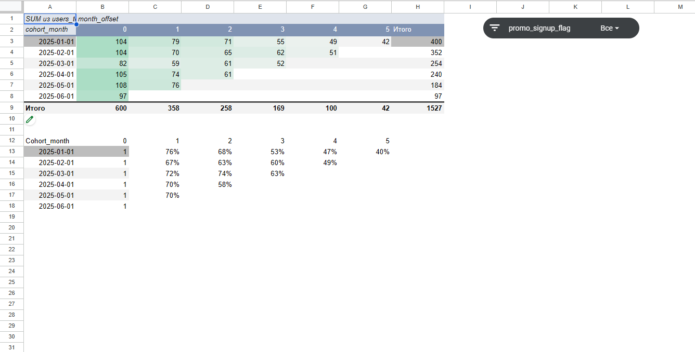

# Когортний аналіз утримання користувачів і каналів залучення

## Опис проєкту

Цей проєкт аналізує утримання користувачів за когортами та порівнює промо- й органічні канали залучення. Робота виконана в межах навчання на курсі Data Analyst у GoIT.

## Мета

Організувати дані про активність користувачів у когорти, розрахувати retention rate у часі та порівняти промо- й органічні групи.

## Інструменти

- SQL
- Google Sheets

## Хід аналізу

1. Очищено вихідні дані та перевірено їх на проблеми, що могли вплинути на аналіз.
2. Об'єднано потрібні таблиці за допомогою SQL joins.
3. Визначено **cohort month** кожного користувача за першою релевантною активністю.
4. Розраховано **month offset** між cohort month і наступними місяцями активності.
5. Розраховано retention rate за когортами та month offset.
6. Порівняно промо- й органічні групи за наявними мітками каналів залучення.
7. Результати представлено в Google Sheets за допомогою pivot tables та conditional formatting.

## Методологія

- **Cohort month:** місяць, у якому користувач уперше виконав умову входження до когорти.
- **Month offset:** кількість місяців між cohort month користувача та місяцем активності.
- **Retention rate:** кількість користувачів, які повернулися в певному місяці, поділена на розмір початкової когорти.

Точна умова входження до когорти, визначення активності та правила сегментації відповідають SQL-запитам і вихідним даним проєкту.

## Основні висновки

- В аналізі використано 600 користувачів: 358 органічних (59,7%) та 242 промо-користувачі (40,3%).
- Органічні когорти були відносно стабільними: приблизно 50–70 нових користувачів на місяць.
- Розмір промо-когорт зріс із 34 користувачів у січні до 47 у червні.
- Утримання органічних користувачів у перший місяць у середньому становило близько 81% і коливалося від 73% до 87%. У січневій органічній когорті на п'ятий місяць залишилося 56% користувачів.
- Промо-когорти мали нижче утримання: у перший місяць у середньому 56%, зі зниженням із 62% для січневої когорти до 47% для травневої.
- На третьому місяці retention становив 32% для січневої промо-когорти та 35% для лютневої, порівняно з 68–80% для органічних когорт.

Порівняння показує, що промо-канал збільшував кількість реєстрацій, а органічні когорти утримували більшу частку користувачів. Наступним кроком може бути перевірка таргетингу та повідомлень у промо-кампаніях.

## Візуалізація

## SQL

[Переглянути SQL-запит](cohort_retention_analysis.sql)

## Примітка щодо даних

Вихідний набір даних не додається до репозиторію, якщо він не є публічним і безпечним для поширення. Конфіденційні дані мають залишатися закритими; за потреби можна використати анонімізований приклад.
