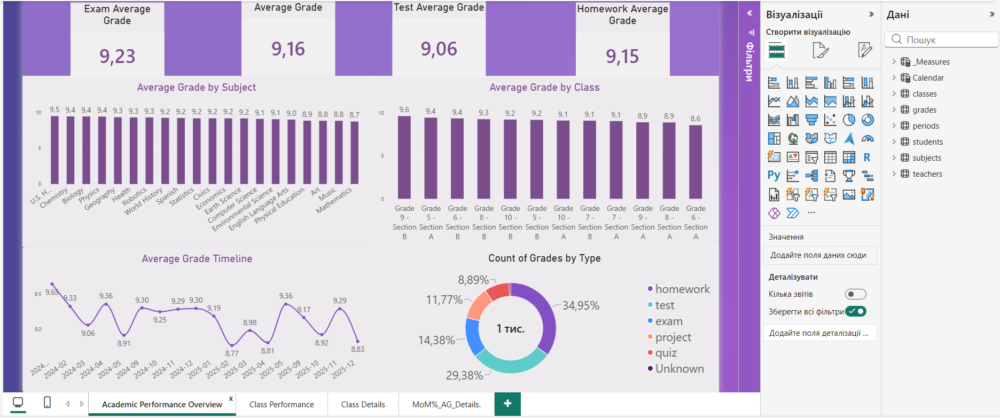
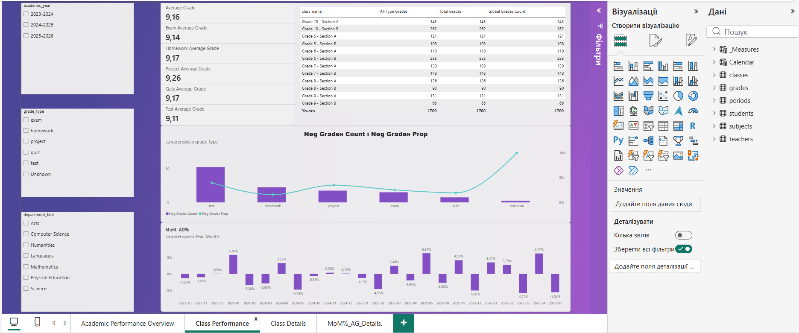

# Дашборд успішності учнів у Power BI

## Опис проєкту

Цей навчальний проєкт об'єднує домашні завдання №10 і №11 курсу Data Analyst у єдиний інтерактивний Power BI-звіт. Дашборд допомагає досліджувати успішність учнів за предметами, класами, типами оцінок і періодами.

## Мета

- Порівняти середні оцінки за предметами та класами.
- Простежити зміну середнього бала в часі.
- Дослідити розподіл типів оцінок і кількість негативних оцінок.
- Надати можливість переходити від огляду класу до деталей за учнями.

## Інструменти та підходи

- Power BI
- DAX-міри в окремій таблиці `_Measures`
- Календарна таблиця та аналіз часової динаміки
- Фільтри, візуальні відбірники та взаємодії між візуалізаціями
- Деталізація за класом
- Підказка з помісячними показниками

## Сторінки звіту

### 1. Огляд академічної успішності

Оглядова сторінка містить KPI-картки середнього бала для загального показника, exam, test і homework. Також на ній показані середні оцінки за предметами та класами, часова динаміка й розподіл оцінок за типами.

### 2. Успішність за класами

Сторінка для аналізу класів із фільтрами за академічним роком, типом оцінки та департаментом. Вона містить багаторядкову картку показників, таблицю мір за класами, комбінацію кількості й частки негативних оцінок та помісячну динаміку `MoM_AG%`.

### 3. Деталізація класу

Сторінка для деталізації обраного класу до рівня учнів і типів оцінок.

### 4. Деталізація помісячної зміни середнього бала

Сторінка-підказка з таблицею середнього бала, значення за попередній період і помісячною зміною `MoM_AG%`.

## Візуалізації

## Примітка щодо даних

Не публікуй у відкритому доступі скріни або файли з реальними персональними даними учнів. Перед завантаженням замаскуй імена, якщо вони не є навчальними або анонімізованими даними.
